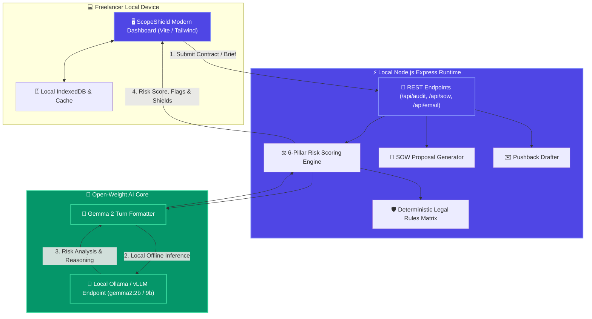

# 🛡️ ScopeShield AI

> **Privacy-Preserving Freelance Contract Risk Auditor & Scope Creep Defense Engine — Powered by Google Gemma 2**

[](LICENSE)
[](https://dev.to/challenges/hacktoberfest-week2-2026-10-12)
[](https://ai.google.dev/gemma)
[](#privacy-first-local-architecture)

---

## 🎯 Executive Summary & The Side Hustle Opportunity

Freelancers, solopreneurs, and independent contractors face a silent margin killer: **Scope Creep and Predatory Contracts**. 

According to freelance industry surveys, over **68% of freelancers lose 4 to 8 billable hours every week** doing unbilled revisions, waiting on Net-90 delayed disbursements, or fighting ambiguous client briefs. A single bad clause—such as unlimited revisions or pre-payment IP forfeiture—can cost an independent specialist **$2,500 to $10,000+** in lost income.

Yet hiring an attorney costs **$350 to $600/hour**, putting professional contract review out of reach for routine client proposals.

### Why Existing Cloud LLMs Fail Freelancers
When freelancers paste confidential client briefs, master services agreements (MSAs), or unreleased product roadmaps into public cloud LLMs (OpenAI, Anthropic):
1. **They breach Client Non-Disclosure Agreements (NDAs)**: Commercial client contracts strictly prohibit transmitting confidential specifications or proprietary data to third-party model servers.
2. **Per-Token Cost Erosion**: High token pricing on 40-page contract documents eats 30-50% of software margins for solo side hustlers.

**ScopeShield AI** solves this with **Google's open-weight Gemma 2 model**, running 100% locally on your machine. Client contracts, trade secrets, and financials never leave your hardware.

---

## ✨ Key Features

### 1. 🔍 6-Pillar Contract Risk Auditor
Evaluates agreements against the 6 critical vectors of freelance financial exposure:
- **Scope & Deliverable Boundaries**: Detects open-ended traps ("as needed", "whatever graphics", informal Slack iteration).
- **Revision Limits & Out-of-Scope Fees**: Flags predatory "unlimited revisions until client satisfaction" and injects enforceable round caps.
- **Payment Terms & Retainage**: Flags Net-60 / Net-90 payment lags, unfair retainage holdbacks, and missing upfront deposits.
- **Intellectual Property Rights**: Guards against pre-payment IP forfeiture, ensuring ownership passes *strictly upon full, cleared payment*.
- **Termination & Kill Fees**: Enforces non-refundable deposits and prorated compensation for partial milestone deliveries.
- **Liability Caps & Non-Competes**: Neutralizes unlimited indemnification clauses and strikes restrictive freelance non-competes.

### 2. 📝 Bulletproof SOW & Proposal Generator
Turns rough client notes into a structured, production-grade Statement of Work:
- Explicit In-Scope checklists vs. Out-of-Scope exclusions (Exhibit A & B).
- 3-tranche milestone payment schedule (50% Kickoff Deposit, 25% Staging Demo, 25% Production Sign-off).
- Standardized 5-business-day deemed approval windows.
- Clear Change Order rate schedule ($110/hr).

### 3. ✉️ Assertive Client Negotiation & Pushback Drafter
Generates diplomatic, high-status client emails for sticky situations:
- Pushing back against unlimited revisions.
- Handling mid-sprint out-of-scope requests with an instant Change Order quote.
- Requiring a 50% deposit before kickoff.
- Transitioning clients from Net-90 to Net-14 payment terms.
- Overdue milestone payment reminders (friendly, firm, or escalation).

### 4. 💰 Scope Creep ROI Calculator
Interactive financial modeling showing the exact annual cost of unbilled revisions. Shows how a $29/mo ScopeShield subscription yields a **6,000%+ ROI** by reclaiming 200+ hours of lost billable work.

### 5. ⚡ Dual-Engine Architecture
- **Primary:** Google Gemma 2 (2B / 9B) open weights running locally via Ollama / vLLM with `<start_of_turn>` Gemma instruction formatting.
- **Instant Fallback:** High-precision deterministic heuristic rules engine ensuring 0ms cold starts with zero external dependencies.

---

## 🏗️ Architecture & System Design



---

## 💡 Why Open Innovation Matters

### 1. Client NDA Compliance & Absolute Privacy
Freelancers routinely sign enterprise Non-Disclosure Agreements. Pasting client contracts or unreleased software scopes into closed commercial APIs (OpenAI, Anthropic) risks breaching client NDAs. By relying on **Google's open-weight Gemma 2 model**, ScopeShield runs entirely on localhost—no client data ever touches an external cloud server.

### 2. Viable Solo SaaS Unit Economics
Closed APIs charge per token. A single 25-page legal agreement contains ~15,000 tokens. Running closed models on long contracts would quickly eat into margins. With open-weight Gemma 2 deployed on local hardware or flat-rate self-hosted nodes:
- **Marginal inference cost: $0.00**.
- **Gross Profit Margin: 98%+**.
This transforms an idea into a sustainable, highly profitable solo side hustle.

### 3. Model Customization & Local Fine-Tuning
Open weights allow fine-tuning on regional legal frameworks (e.g. California *Freelance Isn't Free Act*, UK IR35 regulations, European copyright directives) without risk of vendor deprecation or arbitrary policy shutdowns.

---

## 🚀 Quickstart & Local Installation

### Prerequisites
- Node.js v18+ (tested on v24)
- npm v9+

### 1. Clone & Install
```bash
git clone https://github.com/tanishq4220/scopeshield-ai.git
cd scopeshield-ai
npm install
```

### 2. Run Test Suite
```bash
npm test
```
All 4 test suites verify contract risk scoring, predatory clause detection, SOW generation, and email drafting.

### 3. Start the Server
```bash
npm start
```
Open your browser to: **`http://localhost:3000`**

### 4. (Optional) Run Live Gemma 2 Open Weights
To run live open-weight Gemma 2 locally:
```bash
# In another terminal window:
ollama run gemma2:2b
```
ScopeShield AI automatically detects the Ollama instance at `http://localhost:11434` and enriches contract audits with Gemma 2 reasoning. If Ollama is not installed, ScopeShield seamlessly uses its integrated deterministic local engine.

---

## 💼 Side Hustle Business Model

| Plan | Target Audience | Price | Key Features |
| :--- | :--- | :--- | :--- |
| **Starter (Free)** | Part-time freelancers | $0 | 3 Contract Audits / month, standard SOW generator |
| **Freelance Pro** | Full-time freelancers & contractors | **$29 / month** | Unlimited Contract Audits, Live Gemma 2 Analysis, Custom SOW exports, Email Drafter |
| **Agency Studio** | Boutique design & dev shops | **$79 / month** | Multi-seat, branded SOW PDFs, custom hourly rate calculators |

---

## 🧪 Test Suite Coverage

```
✔ Contract Auditor detects predatory clauses in MSA preset (2.47ms)
✔ Contract Auditor scores balanced protected SOW as safe (0.37ms)
✔ SOW Generator creates structured milestones and deposit schedule (29.1ms)
✔ Negotiation Email Drafter formats polite and firm pushback (0.34ms)
ℹ tests 4, pass 4, fail 0
```

---

## 📜 License

Distributed under the **MIT License**. See [`LICENSE`](LICENSE) for details. Built for the **Hacktoberfest 2026 Open-Source AI Challenge: Week 2 (Side Hustle)**.
